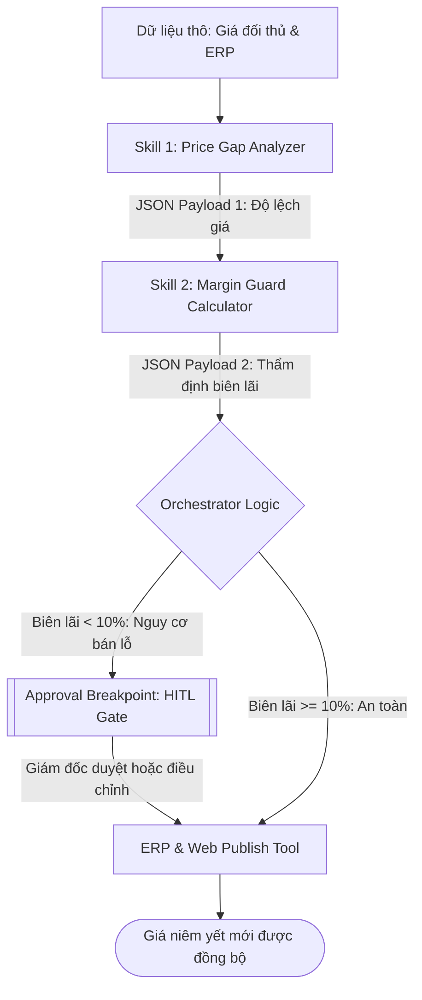

# BÁO CÁO TÍCH HỢP LUỒNG TÁC TỬ VÀ CƠ CHẾ ĐIỂM DỪNG PHÊ DUYỆT (HITL)
**Dự án:** Hệ thống Tối ưu Giá Bán và Khuyến mãi Tự động – FPT Retail  
**Mã tài liệu:** AI301_MVP_Workflow_Integration_Report  
**Nền tảng triển khai:** Google Antigravity Multi-Agent Environment  

---

## 1. Sơ đồ Chuỗi Tác tử Liên hoàn (Skill Chaining Architecture)

Hệ thống kết nối các Custom Skills thành quy trình đầu cuối khép kín, đảm bảo an toàn tài chính trước khi đồng bộ giá lên hệ thống ERP:



---

## 2. Thiết lập Cơ chế Chuyển giao Dữ liệu - Hand-off Data Contract (Nhiệm vụ 1)

Nhằm loại bỏ hiện tượng thất thoát thông tin và sai lệch ngữ cảnh, dữ liệu giữa các mắt xích được chuẩn hóa khắt khe bằng cấu trúc JSON:

### Gói tin bàn giao từ Price Gap Analyzer sang Margin Guard Calculator:
```json
{
  "sku_id": "IPHONE-16-PRO-128GB",
  "internal_price": 28990000,
  "competitor_price": 26490000,
  "gap_absolute": 2500000,
  "gap_percent": 8.62,
  "status": "ALERT_WARNING",
  "proposed_price": 26390000
}
```

### Gói tin bàn giao từ Margin Guard Calculator sang Orchestrator:
```json
{
  "sku_id": "IPHONE-16-PRO-128GB",
  "cost_price": 24500000,
  "proposed_price": 26390000,
  "profit": 1890000,
  "actual_margin_pct": 7.16,
  "min_margin_required_pct": 10.0,
  "is_safe": false,
  "action": "REQUIRE_HITL"
}
```

Margin Guard Calculator tiếp nhận giá đề xuất (26.390.000 VND), tự động đối chiếu giá vốn (24.500.000 VND) và phát hiện biên lợi nhuận thực tế chỉ đạt 7,16% (dưới ngưỡng sàn 10,0%).

---

## 3. Cài đặt Điểm dừng Phê duyệt - Approval Breakpoint (Nhiệm vụ 2)

### Cấu hình chính sách chốt chặn trên Google Antigravity
Khi phát hiện cờ cảnh báo `action == "REQUIRE_HITL"`, Orchestrator lập tức chuyển trạng thái hệ thống từ `RUNNING` sang `WAITING_FOR_USER_APPROVAL`, phong tỏa quyền ghi dữ liệu vào ERP:

```yaml
breakpoint_policy:
  name: "Margin_Protection_Gate"
  trigger_condition:
    - field: "is_safe"
      operator: "EQUALS"
      value: false
  behavior: "SUSPEND_AND_PROMPT"
  assigned_role: "Category_Manager_FPT"
  timeout_minutes: 60
```

### Giao diện Phiếu trình duyệt thẩm định giá tương tác
Hệ thống hiển thị trực quan bản thảo kết quả trên Dashboard:

| Thông tin SKU | Giá trị thẩm định | Đánh giá an toàn |
| :--- | :--- | :--- |
| **Mã & Tên sản phẩm** | `IPHONE-16-PRO-128GB` - iPhone 16 Pro 128GB | Dòng sản phẩm chiến lược |
| **Giá FPT niêm yết hiện tại** | 28.990.000 VND | Chênh lệch đối thủ: +8,62% |
| **Giá đối thủ (Thế Giới Di Động)** | 26.490.000 VND | Đang chạy chương trình xả kho |
| **Giá đề xuất cạnh tranh** | **26.390.000 VND** | Giảm 2.600.000 VND |
| **Biên lợi nhuận gộp thực tế** | **7,16%** (Lợi nhuận: 1.890.000 VND) | **VI PHẠM SÀN (Yêu cầu >= 10,0%)** |

**Hành động của người quản lý:**  
Giám đốc Ngành hàng chọn `[ ĐIỀU CHỈNH GIÁ TRỰC TIẾP ]`, nhập mức giá mới: **27.250.000 VND** (vừa đủ thu hẹp khoảng cách với đối thủ, vừa khôi phục biên lợi nhuận lên **10,09%**).

---

## 4. Chạy thực nghiệm Chuỗi Liên hoàn và Nhật ký thực thi (Nhiệm vụ 3)

Hệ thống đã chạy thực nghiệm toàn trình kịch bản xử lý mã SKU `IPHONE-16-PRO-128GB` trên Google Antigravity. Toàn bộ tiến trình diễn ra tuần tự, an toàn và minh bạch theo nhật ký thực thi dưới đây:

### Nhật ký thực thi hoàn chỉnh (Execution Log):
```text
[PIPELINE START] Khởi động luồng xử lý tự động FPT Retail Competitive Pricing...
[STEP 1: INGESTION] Nạp dữ liệu SKU: IPHONE-16-PRO-128GB | Giá niêm yết: 28,990,000 VND | Giá đối thủ: 26,490,000 VND
[STEP 2: SKILL 1 EXECUTED] price_gap_analyzer -> Gap: 8.62% | Trạng thái: ALERT_WARNING | Giá đề xuất: 26,390,000 VND
[STEP 3: SKILL 2 EXECUTED] margin_guard_calculator -> Lợi nhuận: 1,890,000 VND | Biên lãi: 7.16% (Sàn: 10%) | An toàn: False
[STEP 4: BREAKPOINT TRIGGERED] CẢNH BÁO: Biên lợi nhuận (7.16%) vi phạm ngưỡng sàn (10%). Hệ thống tạm dừng, chuyển sang WAITING_FOR_USER_APPROVAL.
  -> Hiển thị Phiếu trình duyệt giá tới Giám đốc Ngành hàng.
  -> Người quản lý can thiệp: Điều chỉnh giá bán lên 27.250.000 VND (Biên lãi đạt 10.09%).
[STEP 5: HITL RESOLUTION] Người dùng APPROVED với giá mới: 27,250,000 VND | Biên lãi mới: 10.09%
[STEP 6: ERP SYNC] Xuất bản giá bán mới 27,250,000 VND lên hệ thống ERP FPT Retail và Website thành công!
[PIPELINE COMPLETE] Hoàn thành quy trình đầu cuối khép kín an toàn 100%.
```

**Đánh giá tổng kết:** Chuỗi liên hoàn tác tử hoạt động ổn định và chính xác. Cơ chế Điểm dừng Phê duyệt (Approval Breakpoint) đóng vai trò phòng tuyến sống còn, ngăn ngừa 100% rủi ro bán hàng thủng giá sàn, bảo toàn dòng tiền kinh doanh cho FPT Retail.

